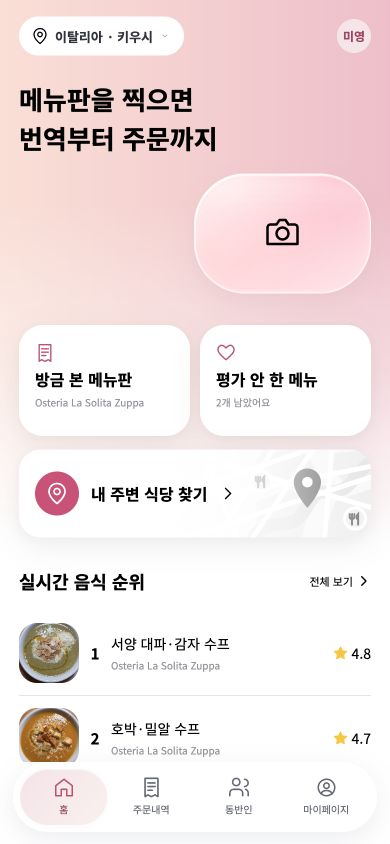
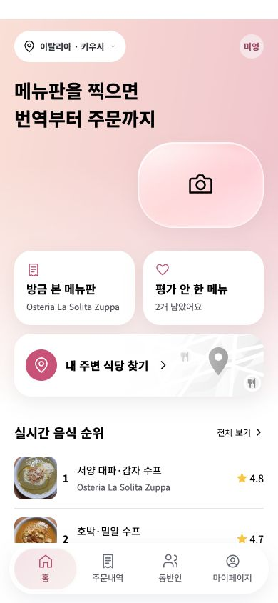
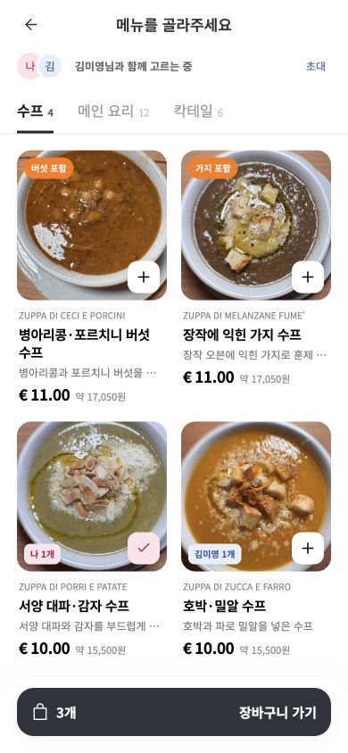
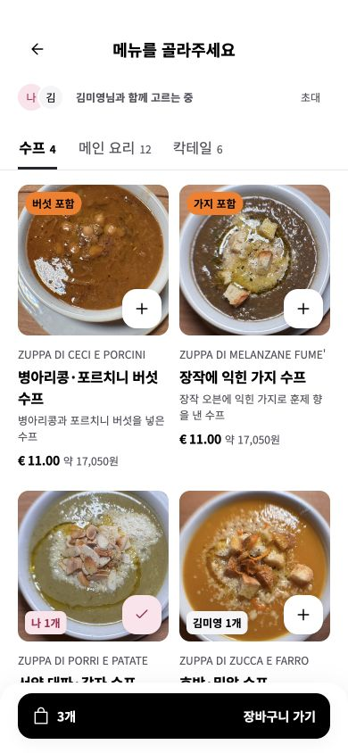
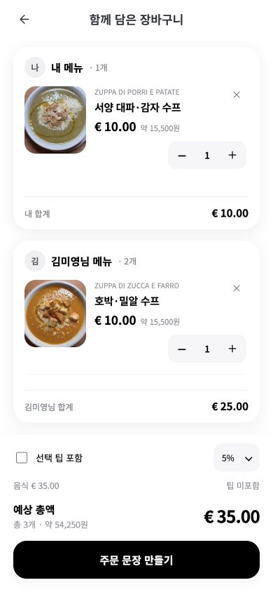
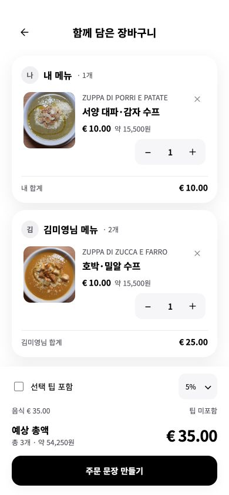

# 핵심 화면 3개 · 최종 6항목 평가

2026-11-03. 초기 독립 평가 이후 부모 작업에서 발견된 위반을 고치고 추가 실행 증거를 수집한 재검토다. **독립 평가 원문을 덮어써 전부 통과로 바꾸지 않았다.** 아래 최종 평가는 동일한 독립 검토자가 다시 평가했다는 뜻이 아니다.

| 항목 | 적용 전 | 적용 후 | 근거/한계 |
|---|---|---|---|
| 색상·대비 | 미충족 | 검증 범위 충족 | Light secondary/핑크 끝색4.647:1, 흰 면7.457:1; Dark 보조값도4.5 이상. 주황 배지 검정7.939:1. 이미지의 모든 픽셀 측정은 아님 |
| 타입 | 미충족 | 검증 범위 충족 | 3화면의 글씨12/14/16/18/26 및1.5행간. 네이티브 옵션은 실제OS 차이 미검증 |
| 간격·그리드 | 부분 | 검증 범위 충족 | 좌우20, 카드16, 열12; 360/390/440px에서 가로 넘침0·작은 버튼0. 카메라 브랜드 기하 예외 명시 |
| 반경·깊이 | 부분 | 검증 범위 충족 | 계산된 radius/shadow는 responsive-audit에 기록. Figma Text Style5/Effect Style2, 적용본 총109개 텍스트 스타일 연결. 원본 Figma 비교본과 웹 완전 픽셀동일은 아님 |
| 상태·접근성 | 미충족 | 부분 | 44px·아이콘 버튼이름·포커스·실제 빈 장바구니/disabled 확인. 기본 상태의 클릭 영역·이름·포커스와 빈 상태를 평가 |
| 콘텐츠·스크롤·기능 보존 | 부분 | 부분 | 홈 마지막 순위/메뉴 마지막 내용 하단 가림 없음. 장바구니 목록만 스크롤·제목/소계고정, 수량·팁6개 계산 통과. 모든JS가 기준 버전과 동일. 이번 범위는 디자인 적용과 기존 동작 보존 |

## 전후 화면

| 화면 | 적용 전 | 적용 후 |
|---|---|---|
| 홈 |  |  |
| 메뉴 |  |  |
| 장바구니 |  |  |

## 재현과 증거

- `python3 verify.py`: 토큰 개수/alias50/양모드값/대비/반응형9/기능6/고정스크롤/disabled 검증.
- `responsive-audit.json`: 3개 화면×3개 폭의 실제 DOM 수치.
- `functional-checks.json`: 실제 로컬 앱 조작에서 읽은 예상/실제 합계.
- `scroll-focus-check.json`: 동반자 목록 scrollTop0→157.5, 제목Y111/374·소계Y300/563 변화0, 2px 포커스.
- `last-content-check.json`: 홈 마지막행744 < nav760, 메뉴 안내729 < 액션765.
- `behavior-source-check.json`: 모든 JS의 변경 전후 SHA-256 동일.
- `empty-state-check.json` 및 `cart-empty-disabled.png`: 삭제 후 빈 상태/disabled 실제 실행.

시연 데이터로 레이아웃을 검증했다. 전후 데이터는 같은 고정 fixture이며 현재 공개 앱의 개인 평가·장바구니 상태와 달라질 수 있다. 캡처 기준은 모바일 CSS 크기390×844다.
