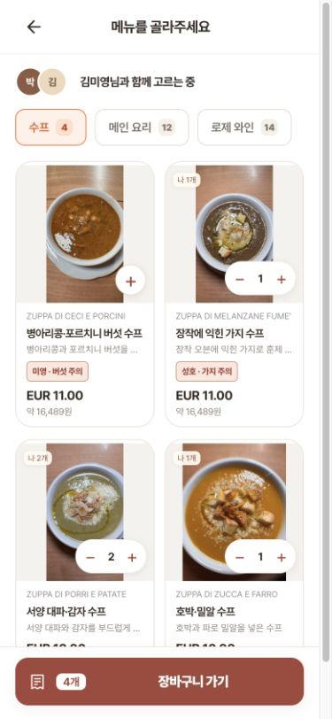
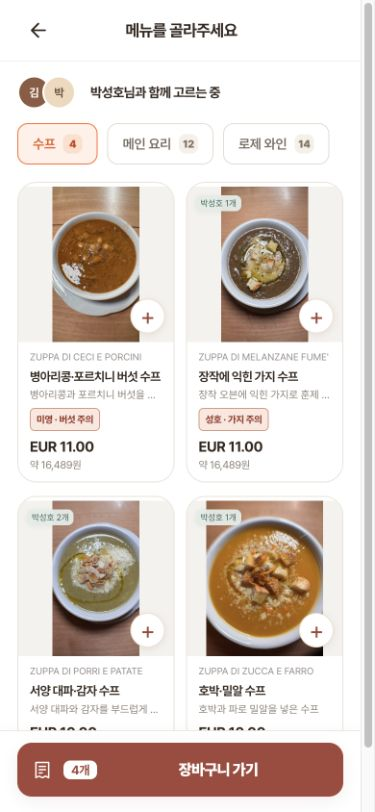
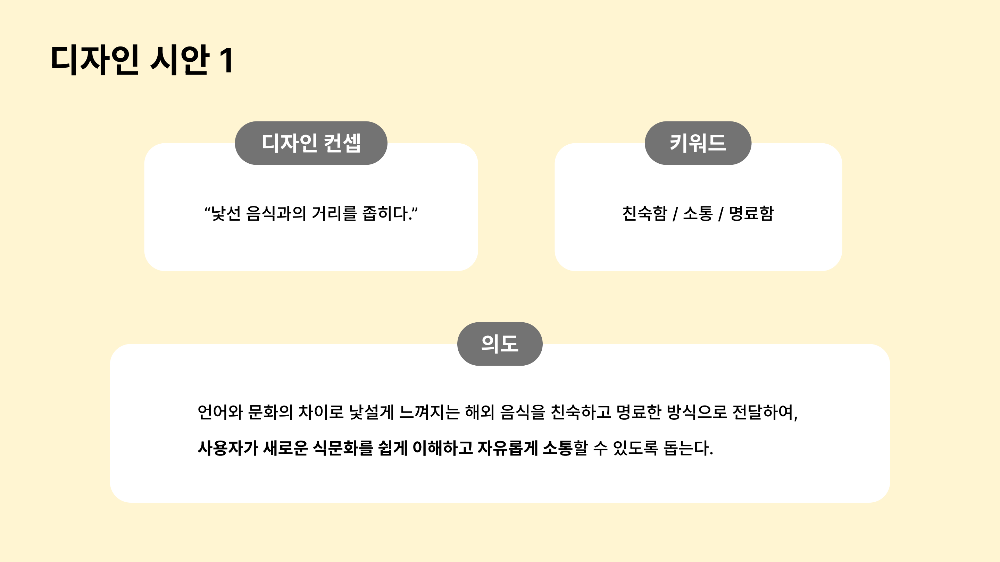
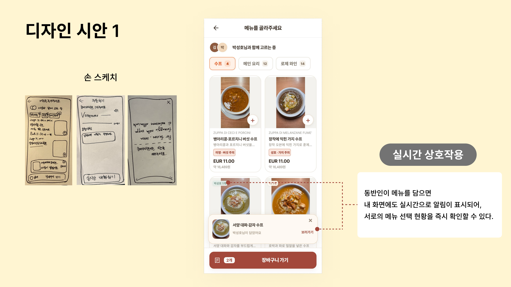
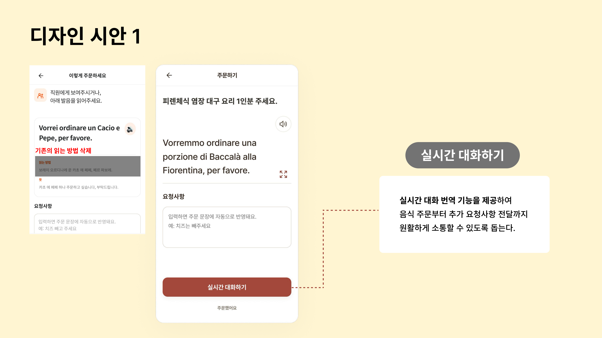
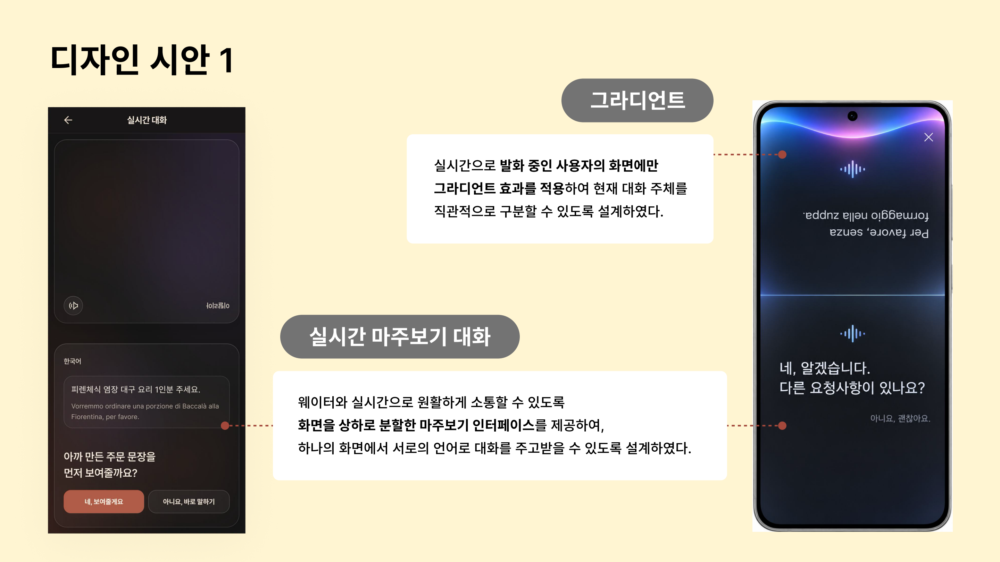

# 7주차 기록

## 한 일

- 사용성 테스트와 피드백을 반영하여 프로토타입 수정
- 동반인과 함께 메뉴를 고르는 상호작용 구체화
- 실시간 대화 화면의 새로운 디자인 아이디어 제안

## 1. 피드백을 반영한 프로토타입 수정

### 메뉴판 촬영 및 사진 확인

여러 장을 촬영할 때 두 번째 사진부터 카메라 화면이 작아지는 문제를 수정하여, 촬영 중에도 같은 크기의 화면이 유지되도록 하였다. 촬영한 사진은 사진 묶음에서 확인하고 확대할 수 있도록 구성하였다.

촬영 안내 문구와 프레임의 위치를 아래로 조정하여 메뉴판 글자를 가리지 않도록 하였으며, 기존의 6장 촬영 제한도 제거하였다.

### 메뉴 탐색과 정보 가독성

메뉴판을 사진 중심의 2열 카드로 재구성하였다. 각 카드에는 **원문 메뉴명 → 한국인이 이해하기 쉬운 한글 메뉴명 → 한 줄 설명 → 현지 가격과 원화 가격** 순서로 정보를 배치하였다.

한글 메뉴명은 최대한 한 줄에 표시하고, 메뉴명과 설명 사이의 간격을 줄여 더 많은 메뉴를 한눈에 비교할 수 있도록 하였다. 카테고리에는 메뉴 개수를 표시하고, 불필요한 안내 문구를 정리하여 메뉴 탐색에 집중할 수 있도록 개선하였다.

### 동반인과 함께 메뉴 담기

박성호와 김미영의 시점을 각각 구성하여, 두 사람이 같은 메뉴판을 보면서 메뉴를 선택하는 흐름을 구현하였다.

동반인이 메뉴를 담으면 알림이 표시되고, 2초 뒤 자동으로 사라지도록 하였다. 알림이 사라진 뒤에도 메뉴 사진 위에는 **“나 1개”, “김미영 1개”**처럼 선택한 사람과 수량이 남도록 하였다. 자신의 선택과 동반인의 선택은 색상으로 구분하여 서로의 선택 현황을 쉽게 확인할 수 있도록 하였다.

또한 박성호의 가지 알레르기와 김미영이 버섯을 먹지 못한다는 설정을 반영하여, 관련 메뉴에 재료 주의 표시를 추가하였다. 주의 표시는 붉은 배경과 굵은 글씨로 강조하였다.

### 주문 문장과 대화 기능

주문 화면의 ‘크게 보기’ 문구를 확대 아이콘으로 바꾸고, 소리 아이콘과 같은 오른쪽 축에 배치하였다. 확대 화면에서는 주문 문장을 더 굵고 크게 표시하고 위쪽에 정렬하여 직원이 읽기 쉽도록 하였다.

주문 문장에 추가 요청사항을 반영하고, 주문 화면에서 실시간 대화 기능으로 이어질 수 있도록 흐름을 정리하였다.

## 2. 새로운 디자인 아이디어

### 디자인 컨셉

**“낯선 음식과의 거리를 좁히다.”**

언어와 문화의 차이로 낯설게 느껴지는 해외 음식을 친숙하고 명료하게 전달하여, 사용자가 새로운 식문화를 쉽게 이해하고 자유롭게 소통할 수 있도록 하는 것을 목표로 하였다.

디자인 키워드는 **친숙함·소통·명료함**으로 설정하였다.

### 마주보기 대화 화면

한 기기를 사이에 두고 사용자와 직원이 마주 보며 대화할 수 있도록 화면을 위아래로 나누는 아이디어를 구상하였다. 상대방이 읽는 영역은 180도 회전하여 각자의 방향에서 문장을 읽을 수 있도록 하였다.

자신이 말한 문장은 오른쪽, 상대방이 말한 문장은 왼쪽으로 정렬하여 발화자를 구분하고자 하였다. 현재 대화 문장은 크게 표시하고, 이전 문장은 작고 흐리게 표현하여 대화의 흐름을 유지하는 방향을 제안하였다.

### 발화 상태를 보여주는 글라스와 그라디언트

어두운 글라스 재질을 바탕으로, 현재 말하는 사람 쪽에 핑크·라벤더·블루 계열의 그라디언트가 번지는 시안을 제작하였다. 색의 변화로 현재 누가 말하고 있는지 직관적으로 파악할 수 있도록 하는 것이 목적이다.

이 디자인은 **새로운 방향을 검토하기 위한 예시 시안이며, 현재 프로토타입에는 적용하지 않았다.**

## 3. 결과물

### 박성호 시점 프로토타입

[박성호 시점 사이트 열기](https://hanip-europe-menu.alswn2963.chatgpt.site/?prototype=1ec56f09-d5ed-475c-872b-1849267969c8&person=seongho)

자신이 담은 메뉴와 김미영이 담은 메뉴를 구분하고, 동반인의 선택 알림과 공동 장바구니를 확인할 수 있다.

### 김미영 시점 프로토타입

[김미영 시점 사이트 열기](https://hanip-europe-menu.alswn2963.chatgpt.site/?prototype=1ec56f09-d5ed-475c-872b-1849267969c8&person=miyeong)

같은 메뉴판을 김미영의 입장에서 확인하며, 박성호가 선택한 메뉴와 수량을 확인할 수 있다. 두 사이트는 같은 공유 장바구니에 연결된다.

### 디자인 정리 자료

첨부한 디자인 자료의 각 페이지를 이미지로 정리하였다. 원본 파일명은 ‘8주차 과제’이지만, 요청한 기록 주차에 맞춰 이 문서는 **7주차 기록**으로 작성하였다.

[디자인 정리 자료 원본 PDF 보기](week07-assets/design-reference.pdf)

#### PDF 1페이지: 디자인 컨셉·키워드·의도

#### PDF 2페이지: 손 스케치와 동반인 메뉴 담기 상호작용

#### PDF 3페이지: 주문 화면과 실시간 대화 진입

#### PDF 4페이지: 마주보기 대화와 발화 그라디언트 디자인 아이디어

## 4. 이번 주 리뷰 및 배운 점

이번 수정에서는 기능을 추가하는 것뿐만 아니라, 사용자가 기능과 현재 상태를 쉽게 알아차릴 수 있도록 만드는 데 집중하였다. 촬영 화면의 크기를 유지하고 메뉴 정보를 간결하게 정리하여 사용 흐름과 가독성을 개선하였다.

특히 함께 메뉴를 고르는 상황에서는 일시적인 알림과 지속적으로 남는 선택 표시가 서로 다른 역할을 한다는 점을 확인하였다. 알림은 동반인의 행동을 알려주고, 이름·수량 표시는 현재 선택 상태를 확인하는 데 도움을 준다.

새로운 대화 디자인에서는 정렬과 색을 통해 발화자와 대화 상태를 구분하는 방법을 탐색하였다. 이후에는 이 시안이 실제 마주보기 상황에서도 이해하기 쉬운지 사용성 테스트를 통해 확인할 필요가 있다.
