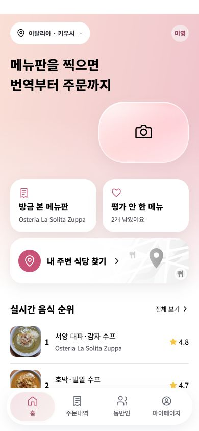
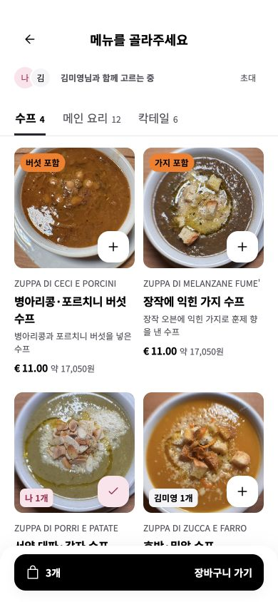
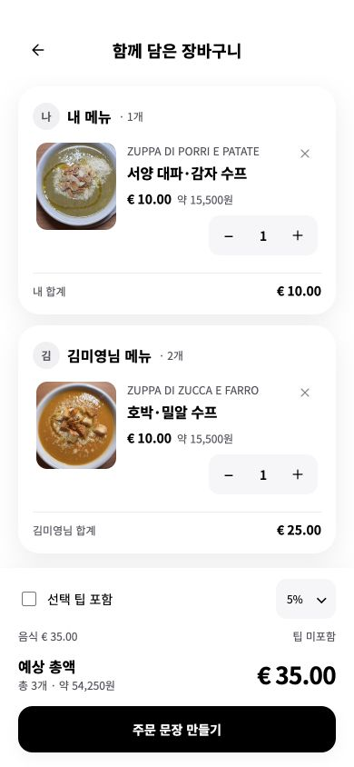

# 9주차 기록

## 이번 주에 한 일

이번 주에는 Codex와 함께 한입의 주요 화면을 수정하고 Figma와 웹 화면을 비교했다. 반복 수정으로 글씨·간격·그림자가 달라지는 문제를 발견해, 최종적으로 DESIGN.md를 작성하고 화면에 적용·검증하는 작업으로 정리했다.

## 1. 주요 화면 개선

| 화면 | 정리한 내용 |
|---|---|
| 홈 | 피치 핑크 그라데이션, 리퀴드 글래스 카메라, 작은 동반자 프로필, 최근 메뉴·미평가 메뉴, 주변 식당 배너, 세로 순위5개·원문·전체 보기 |
| 촬영·분석 | 흰 촬영 프레임 크기·하단 위치, 플래시/취소 배치, 사진 수 표시, 짧은 촬영 알림, 핑크 해석 버튼, 불필요한 안내 정리 |
| 식당·주변 탐색 | 구글맵 표시, 식당 확인 위계, 근처 식당 사진·출처 위치, 전체/아시안/한식당 분류 검토 |
| 메뉴판 | 흰 배경 2열, 원문→해석명→설명→EUR/원화, 사진 안 못먹는 재료 배지, 담은 사람 표시 |
| 메뉴 상세 | 한국 음식 비교·메뉴판에 적힌 정보·AI 추정 정보 분리, 평점·리뷰 더보기·전체 사진 보기, 불필요한 문구 정리 |
| 장바구니 | 내 메뉴/동반자 메뉴를 이름·카드로 구분, 고정 제목·소계와 독립 음식 스크롤, 팁5/10/15/직접 입력 |
| 주문·영수증 | 메뉴와 같은 흰 화면 위계, 주문 문장과 요청 정리, 영수증의 금액 열·합계·안내 구분, 피치 핑크 색감 유지 |
| 계정·동반자 | 마이페이지·주문내역은 흰 화면, 동반자 흐름은 홈과 연결되는 표현 |

## 2. DESIGN.md가 필요했던 이유

화면마다 수정이 쌓이면서 같은 보조 글자에10/11/12px가 섞이고 좌우19px·열13.5px 같은 간격도 남았다. 먼저 기존 CSS의 선언 값을 합치거나 이름을 붙이지 않은 원자료로 추출했다. 과거 덮어쓰기 선언과 실제 화면의 계산된 값은 구분해서 기록했다.

이후 사용자 요청을 바탕으로 채택·통합·추가·예외를 결정했다. 별도의 팀 회의나 투표가 있었다고 기록하지 않는다. 기존 디자인을 전면 교체하기보다 피치 핑크와 핵심 구성은 유지하고 규칙을 통일했다.

## 3. 25개 디자인 토큰과 문서

- Color9 / Type5 / Space6 / Rounded3 / Shadow2의 의미 토큰25개를 정했다.
- Figma에 Primitive30개를 먼저 생성하고 Semantic25개를 Light/Dark 값에 참조로 연결했다. 실제 총 변수55개와 과제의 의미 토큰25개를 구분했다.
- 글씨는 Noto Sans KR, 12/14/16/18/26px의5단계, 간격은4/8/12/16/20/24px, 반경은12/16/24px로 정리했다.
- Figma에 Text Style5개와 Light Effect Style2개를 만들었다. 그림자는 전용 Variable 타입이 없어 STRING alias와 Effect Style을 함께 제공했다.
- Google 공식 DESIGN.md의8개 섹션 순서를 따르고 YAML에 토큰을 넣었다. 그림자는 공식 키가 없어 프로젝트 확장임을 명시했다. 공식 CLI0.4.0 검사 결과 errors0/warnings0이었다.
- AGENTS.md에 “UI를 만들거나 고치기 전에 DESIGN.md를 읽는다.”를 넣었다.

## 4. 핵심 화면 적용과 검증

첫 새 대화에서 DESIGN.md를 읽고 홈·메뉴판·장바구니에 적용했다. 다른 새 대화에서는6항목으로 독립 평가를 받았다. 독립 평가 원문은 보존하고, 이후 수정과 재검증을 별도로 기록했다.

독립 검토에서 회색 보조 글자와 핑크 끝색의 대비3.757:1 문제가 발견됐다. 보조색을#62626C에서#55545E로 바꾸어4.647:1로 교정했다. 아바타·수량 기호의 행간과 임의2px간격도 정리했다. 못먹는 재료의 주황색은 살리고 작은 흰 글자를 검정으로 바꿔 대비7.939:1을 확보했다.

| 확인 항목 | 결과 |
|---|---|
| 의미 토큰25개 / 두 모드 참조50개 | 누락·참조 불일치0 |
| 홈·메뉴·장바구니 ×360/390/440px | 가로 넘침0, 44px 미만 버튼0, 정의 밖 글씨 행간0 |
| 메뉴 담기·수량 증감·삭제 | 실제 로컬 앱에서 확인 |
| 팁5/10/15/직접 입력7.5% | 예상 합계와 실제 표시6개 확인 일치 |
| 장바구니 독립 스크롤 | 음식만 움직이고 제목·소계 위치 변화0 |
| 빈 상태·비활성 주문 | 실제 삭제 후 확인 |
| API·계산 JS 보존 | 디자인 적용 전후 모든JS SHA-256 동일 |

### 적용 화면

## 5. 규칙 보완과 남은 일

검토 후 아바타/기호 행간, 검수 폭·배율, 비텍스트 대비·포커스/이름, 로딩·빈·오류 증거, 그라데이션 양 끝 대비 규칙(D13~D17)을 추가했다.6항목 최종 평가에서 색상·타입·그리드·표면은 검증 범위에서 충족했지만 접근성과 전체 기능은 미검증 범위가 남아 부분으로 기록했다.

메뉴판 사진 인식·Gemini 검색·구글맵 정보 연결 구조도 함께 검토했다. 이번 과제 기록은 화면 디자인 규칙과 적용 결과를 중심으로 정리했다.

COMPASS Design System1.0.15는 현재 정적 앱/Android 의존성과 Figma 로컬 라이브러리에서 설치를 확인하지 못했고 임의 버전을 설치하지 않았다. Dark는 토큰 값만 제공하며 앱의 Dark 출시를 뜻하지 않는다. Figma 적용본은 편집 가능한 원본 복제에 토큰을 연결한 비교본으로, 최종 웹과 완전한 픽셀 동기화는 남은 작업이다.

## 6. 산출물

- [DESIGN.md](https://github.com/SMWUmeide/meide/blob/design/DESIGN.md)
- [AGENTS.md](https://github.com/SMWUmeide/meide/blob/design/AGENTS.md)
- [9주차 제출물·6항목 평가·변수 export·전후 캡처](https://github.com/SMWUmeide/meide/tree/design/design/mj/week09)
- [Figma · 한입 홈 화면 편집 ·9주차 규칙](https://www.figma.com/design/8LZ8hgBkYEi8fFa2U96F2L?node-id=87-2)
- [한입 실행 화면](https://hanip-home-peach-lavender.smvd-userone-7982.chatgpt.site/#home)

기록일:2026-11-03. 캡처는 동일 시연 메뉴와 환율을 사용한 모바일 CSS 크기의 브라우저 검수이며 화면 비교 자료다.
